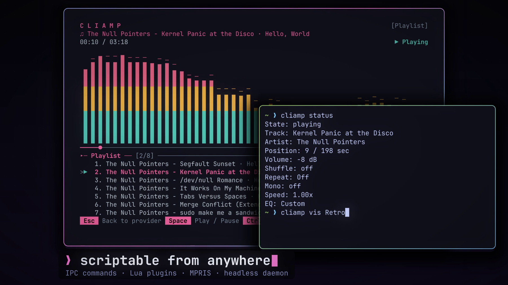

# cliamp

A neon synthwave theme for [Omarchy](https://omarchy.org). The colors come from the [cliamp](https://cliamp.stream) promo video.



## Install

```sh
omarchy theme install https://github.com/cliamp/omarchy-cliamp-theme
```

Omarchy installs the theme as `cliamp` and applies it. To apply it again later, run:

```sh
omarchy theme set cliamp
```

## What the theme changes

- Window borders use a cyan, purple, and pink gradient.
- The accent is neon pink. Omarchy uses it for prompts, selections, and the keyboard backlight.
- Icons use `Yaru-magenta`.
- Omarchy generates the terminal, btop, Neovim, and shell colors from `colors.toml`.

## Palette

| Role | Color |
|---|---|
| Accent | `#ff7edb` |
| Border gradient | `#7dcfff` → `#bb9af7` → `#ff7edb` |
| Background | `#12121c` |
| Foreground | `#c0caf5` |
| Bright foreground | `#e6e9ff` |
| Dim foreground | `#8b93c7` |
| Red | `#f7768e` |
| Green | `#9ece6a` |
| Yellow | `#e0af68` |
| Blue | `#7aa2f7` |
| Magenta | `#bb9af7` |
| Cyan | `#7dcfff` |

## Wallpapers


The theme includes 3 wallpapers at 2880x1800:

| File | Description |
|---|---|
| `1-cliamp-neon.png` | The neon cliamp logo over a synthwave grid |
| `2-segfault-sunset.png` | A striped sun on the horizon |
| `3-dot-grid.png` | A dark dot grid with a low purple glow |

To show the next wallpaper, run `omarchy theme bg next`.

## Customize

Edit `~/.config/omarchy/themes/cliamp/colors.toml`. Then run `omarchy theme set cliamp` to apply the change.
